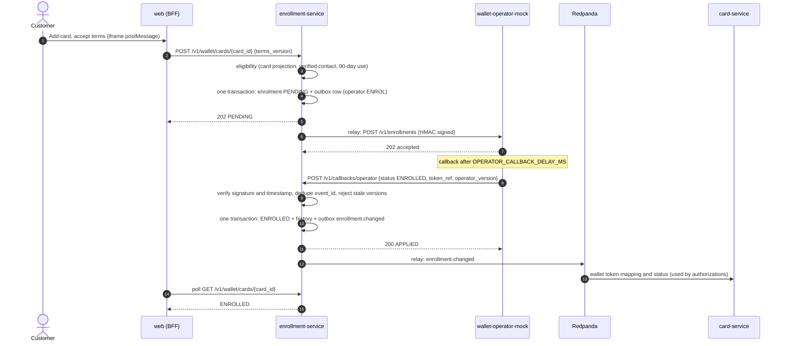
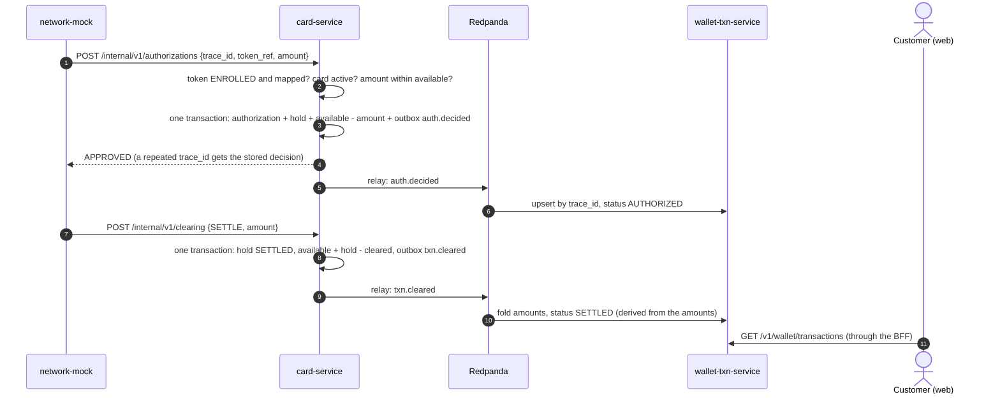

# CardVault architecture

CardVault simulates one bank's side of a bank-backed online checkout wallet. It is an
application under test: every decision below favours production-like behaviour and
testability over features. This file records each decision and its tradeoff. It grows with
each build phase; sections for later phases are marked as such.

Status: **phase 6, complete** (platform, auth-service, card-service, network-mock,
profile-service, enrollment-service with reconciliation, wallet-operator-mock,
wallet-txn-service, web app, CI, seeded bugs).

## 1. Services and responsibilities

| Component | Port | Responsibility | Phase |
|---|---|---|---|
| auth-service | 8001 | Login with lockout, RS256 access tokens, rotating refresh tokens, JWKS | 1 |
| card-service | 8002 | Card master, authorization decisions, holds, clearing | 2 |
| enrollment-service | 8003 | Wallet enrolment system of record, eligibility, operator pushes, callbacks, reconciliation | 3 |
| wallet-txn-service | 8004 | Wallet transaction system of record, disputes, CSV export | 4 |
| profile-service | 8005 | Contact details and verification | 3 |
| web | 3000 | Next.js UI and BFF | 5 |
| wallet-operator-mock | 8101 | External wallet operator (controllable) | 3 |
| network-mock | 8102 | Card network and merchant simulator (controllable) | 2 |
| postgres | 5432 | One Postgres 16 instance, one database per service | 1 |
| redpanda | 19092 (host) | Kafka API | 1 |
| console | 8080 | Redpanda Console (local only, not in CI) | 1 |

Port 8006 is reserved for the future agent service.

### Service map

Solid arrows are synchronous HTTP; dotted arrows are Kafka topics (producer to consumer).
Every event and every call to the operator leaves through the sender's outbox.

```mermaid
flowchart LR
  browser([Browser]) --> web[web: Next.js UI + BFF]
  web --> auth[auth-service]
  web --> card[card-service]
  web --> enr[enrollment-service]
  web --> wtx[wallet-txn-service]
  web --> prof[profile-service]
  browser -. terms iframe .-> op
  net[network-mock] -- authorizations, clearing --> card
  enr -- enrol / suspend / resume / update / remove, HMAC --> op[wallet-operator-mock]
  op -- callbacks, HMAC --> enr
  enr -- daily file, HMAC --> op
  card -. card.lifecycle .-> enr
  prof -. contact.updated .-> enr
  enr -. enrollment.changed .-> card
  card -. auth.decided, txn.cleared .-> wtx
  auth & card & enr & wtx & prof --- pg[(Postgres: one database per service)]
  card & enr & wtx & prof --- rp[(Redpanda)]
```

Services check customer tokens themselves against auth-service's JWKS, so the BFF forwards
the access token and holds no business logic.

## 2. Repository and build

**One Python project for all services (`app/pyproject.toml`, one `uv.lock`).** Each
service is a package (`services.auth`, later `services.card`, ...) and imports the
`shared` package directly.
*Tradeoff:* every service carries the same dependency set, and a dependency bump touches all
of them at once. In return there is one lock file, one dependency layer shared by every
image (so CI builds the heavy layer once), and no publishing step for `shared`. For a
handful of small services owned by one team this is the right call; independent release
cadences would argue for per-service projects.

**One Dockerfile for every Python service (`app/Dockerfile`, `ARG SERVICE`).** The
dependency layer is installed before any code is copied, so code changes rebuild in seconds.
The container entrypoint (`shared/entrypoint.py`) runs that service's Alembic migrations,
then starts uvicorn. Images run as a non-root user.
*Tradeoff:* migrations at start-up are simple and keep `docker compose up` a single step,
but they would race with more than one replica. Each service runs one replica here.

**Relays and consumers run in-process** as asyncio background tasks, not as extra containers
(spec 16.10 rule 66).
*Tradeoff:* fewer containers fit the 2 vCPU runner; the cost is that a slow relay shares a
process with the API. `/test/quiet` exposes outbox depth and consumer lag, so tests can wait
on them.

## 3. Data

**One Postgres container, one database per service.** Each database has an owner role
(`<db>_svc`, used by the service) and a read-only role (`<db>_ro`, for tests); default
privileges give the read-only role `SELECT` on every table the owner creates. Created once by
`app/infra/postgres/01-databases.sh`.
*Tradeoff:* a real deployment would use separate instances. Separate databases still give
the property that matters for testing: no service can join across another's tables, so all
cross-service data flows through APIs and events.

**Schema migrations: Alembic per service**, hand-written, in `services/<name>/migrations`.

**Money** is integer cents plus `currency: "USD"` everywhere. **Time** is UTC, ISO-8601.

## 4. Cross-cutting platform (`app/shared`)

| Module | What it does |
|---|---|
| `runtime.py` | `create_app()`: logging, middleware, error handlers, `/health`, `/ready`, `/test/*`, lifecycle of DB, Kafka, relays and consumers |
| `correlation.py`, `middleware.py` | Accept or generate `X-Correlation-ID`, echo it, keep it in a context variable; access log line per request; last-resort 500 in the common shape |
| `logging.py` | JSON log lines with `correlation_id`; masks PAN-like digit runs, JWTs and token references |
| `errors.py` | One error shape: `{error_code, message, correlation_id, details?}` |
| `clock.py` | The shared clock (section 6) |
| `security.py` | JWT verification via JWKS, service keys, test key |
| `hmac_auth.py` | HMAC-SHA256 signing and verification for operator callbacks |
| `events/` | Envelope, topic names, payload models, JSON Schema export |
| `kafka.py` | Topic creation, producer, consumer runner with retries and DLQ |
| `outbox.py` | Transactional outbox table and relay |
| `faults.py` | Runtime fault injection |
| `bugs.py` | Seeded-bug flags (all off by default) |
| `testsupport.py` | `/test/reset`, `/test/seed`, `/test/faults`, `/test/clock`, `/test/quiet` |
| `idempotency.py` | `Idempotency-Key` storage and replay (section 9) |
| `pagination.py` | Keyset cursor pagination (section 9) |
| `http_client.py` | httpx client that always sends the correlation ID (and a service key) |
| `seed_ids.py`, `seed_data.py` | Fixed customer, card, enrolment and token IDs shared by every service and mock |

**Correlation IDs.** The middleware is plain ASGI rather than Starlette's
`BaseHTTPMiddleware`, so the context variable it sets is the one the handler sees and
streaming responses are not buffered. Incoming IDs are accepted only if they match
`[A-Za-z0-9._:-]{1,128}`; anything else is replaced, so a caller cannot inject text into logs.
The relay restores the ID stored with each outbox row, and the consumer restores the ID
from each event envelope, so one ID follows a request across services and Kafka hops.

**Errors.** FastAPI validation errors are converted to `422 VALIDATION_ERROR` with
`details` listing `loc`, `msg` and `type` only. The raw `input` is dropped because it can
echo secrets (a password) back to the caller. Every code is listed in `docs/errors.md`.

**Log redaction in the formatter.** PAN-like digit runs (13 to 19 digits), JWTs and
`tok_...` references are masked when the line is formatted, not at each call site.
*Tradeoff:* a regex can mask a harmless long number. That is acceptable: a false positive
costs a less useful log line, a false negative leaks card data.

## 5. Authentication

### Customers (auth-service)

- **Access tokens:** RS256 JWTs, 15 minutes. Claims: `sub` (customer_id), `iss`,
  `aud=cardvault`, `exp`, `iat`, `jti`; `kid` in the header.
- **Verification is local in every service** against the JWKS from auth-service, cached by
  `kid` and re-fetched when an unknown `kid` appears (at most every 5 s).
  *Tradeoff:* no network call per request, and auth-service is not a single point of
  failure for reads. The cost is that an access token cannot be revoked before it expires;
  the 15-minute lifetime bounds that window. auth-service verifies its own tokens from memory.
- **`exp` is checked against the shared clock**, not the wall clock: PyJWT's own time checks
  are disabled and replaced, so tests can expire a token by moving the clock (smoke does this).
- **Signing key:** generated on first start and stored in auth's database.
  *Tradeoff:* no private key is ever committed, and tokens survive restarts. A production
  system would keep the key in a KMS/HSM and rotate it; the JWKS-by-`kid` design already
  allows rotation.
- **Refresh tokens:** opaque random strings, 7 days, stored only as SHA-256 hashes. Each
  login starts a *family*; every refresh marks the presented token used and issues a new
  one in the same family. **Presenting a used token revokes the whole family**
  (`REFRESH_TOKEN_REUSED`), because it means two parties hold the same token.
  *Tradeoff:* a client that retries a refresh after a lost response logs itself out. That is
  the accepted cost of theft detection.
- **Logout** revokes the token's family and always returns 204, even for an unknown token,
  so it cannot be used to test tokens.
- **Lockout:** per username, 5 failures lock it for 15 minutes on the shared clock
  (`423 ACCOUNT_LOCKED`). Unknown usernames are counted too, and an unknown username and a
  wrong password both return `401 INVALID_CREDENTIALS`. A dummy hash is verified for unknown
  users so both paths take the same time. The counter row is locked (`SELECT ... FOR
  UPDATE`) so concurrent attempts are counted exactly, and the failure is committed before
  the 401 is raised.
  *Tradeoff:* per-username lockout lets anyone lock a known username (a denial of service on
  that account). Per-IP throttling would be the usual companion; it is out of scope here.
- **Passwords:** stdlib `hashlib.scrypt` (n=2^14, r=8, p=1), run in a worker thread.
  *Tradeoff:* avoids a dependency; argon2id would be the first choice where a library is fine.

### Services and tests

- **Service keys:** one `X-Service-Key` per caller (network-mock, wallet-operator-mock,
  tests), compared in constant time. Internal endpoints reject customer JWTs and customer
  endpoints reject service keys, both with 401. card-service's internal API accepts the
  network-mock and tests keys only.
- **Test controls** are mounted only when `TEST_MODE=true` (otherwise the routes do not exist,
  so they return 404) and need `X-Test-Key`.

### Operator callbacks (and the bank's requests to the operator)

`X-Timestamp` is Unix seconds; the signed string is `"{timestamp}.{raw_body}"`; `X-Signature`
is lowercase hex HMAC-SHA256. The signature is checked before the timestamp window, so a
forged request learns nothing about the window. A timestamp more than 300 s away from the
shared clock (past or future) is rejected; exactly 300 s is accepted. Replay inside the
window is stopped by `event_id` deduplication, and stale `operator_version`s are ignored.

The bank's requests to the operator are signed the same way with the same shared secret
(`OPERATOR_HMAC_SECRET`), so the operator mock can reject unsigned calls too. *Tradeoff:*
one secret for both directions is simpler to rotate as a pair but means a leak of either
side's copy lets an attacker speak for both; production would use one key per direction.

### 404 versus 403 for another customer's resource

A customer asking for another customer's resource gets **404**, the same as for a resource
that does not exist. A 403 would confirm that the ID exists and let an attacker enumerate
IDs. *Tradeoff:* support staff lose the distinction in logs; it is kept in the server log.

## 6. The shared clock

Business rules (eligibility, expiry, lockout, JWT expiry, OTP cooldown, callback timestamps,
reconciliation dates) read time only from `shared.clock.now()`.

- Production mode: real UTC.
- TEST_MODE: real UTC plus an offset stored in **one row** of the `testsupport` database. A
  background task in each process re-reads it every 0.5 s, so a cached offset is at most
  ~1 s old. `now()` stays synchronous with no I/O per call.
- `POST /test/clock` on any service writes the row and updates that service's cache before
  returning; other services follow within 1 s. `GET /test/clock` on each service shows its
  effective time. `make reset` clears the offset.
- Relay backoff, consumer retries, mock delays and UI polling use **real** time, so moving
  the clock never stalls the system.

*Tradeoff:* a DB row instead of a broadcast is simpler and survives restarts; the price is a
bounded 1 s lag between services, which tests absorb by reading `GET /test/clock`.

## 7. Events, outbox and delivery

**Envelope:** `{event_id, event_type, version, occurred_at, correlation_id, payload}`;
`event_type` is the topic name. Pydantic models in `shared/events`; JSON Schemas exported to
`docs/events/`. CI regenerates them and fails if they differ from the committed files.

**Topics** (3 partitions each): `card.lifecycle`, `contact.updated`, `enrollment.changed`,
`auth.decided`, `txn.cleared`, DLQs `enrollment.dlq` and `wallet.txn.dlq`. All keyed by
`card_id` except `contact.updated` (keyed by `customer_id`), so per-card order holds within a
partition. Services create topics at start-up (idempotent), so there is no init container.

**Transactional outbox.** A service writes its business rows and an `outbox` row in one
transaction; an event, or an outbound operator call, exists if and only if the commit
succeeds. The relay:

- picks only the **oldest pending row per key** (`DISTINCT ON (key)`), so a failing event
  blocks later events for the same card instead of being overtaken;
- locks rows with `FOR UPDATE SKIP LOCKED`, so a second relay would not double-send;
- marks a row published after the broker acknowledges it (`acks=all`). A crash between the
  two re-sends it: delivery is **at-least-once** and every consumer dedupes by `event_id`;
- backs off in real time (`base * factor^(n-1)`, capped; from env, with fast defaults in
  TEST_MODE). Event rows retry forever; operator calls stop after 5 attempts, or at once
  when the handler raises `PermanentDeliveryError` (an operator 4xx), and run a give-up hook
  in the same transaction;
- can be limited to some row kinds: enrollment-service runs one relay for events and one
  for operator calls, so a slow operator never delays events.

*Tradeoff:* polling adds up to 250 ms latency (the API also wakes the relay right after a
commit); change-data-capture would remove the poll but adds infrastructure.

**Consumers** commit offsets only after the handler succeeds. Malformed events (schema
validation fails or unknown envelope `version`) are retried 3 times, then sent to the DLQ
with the source topic, partition, offset and error as headers. Other errors retry with
backoff and block the partition, which preserves per-key order at the cost of
head-of-line blocking. `/test/reset` holds relays and consumers before truncating: each
takes a lock around one message (or one drain) and checks the hold flag inside it, so once
the hold returns nothing is running (an earlier event flag let a message slip through and
deadlock against the truncate). The consumer loop logs and survives any error, because a consumer
task that dies quietly looks exactly like an idle one.

The relay, a forced publish failure (`fail_next: 2`), per-key ordering and DLQ routing were
exercised against the running Redpanda during phase 1.

## 8. Card-service (phase 2)

### Card data

- The full card number (PAN) exists only in card-service, encrypted with **AES-256-GCM**
  (`CARD_PAN_KEY`, 32 bytes). The `card_id` is bound as associated data, so a ciphertext
  copied to another row does not decrypt. APIs return `last4` and `expiry`, never the PAN.
  *Tradeoff:* the key sits in an env var; production would use a KMS with envelope
  encryption and key rotation (the `v1:` prefix leaves room for a new scheme).
- Seed and test PANs use the fictional prefix `990000` and a valid Luhn digit.
- `limit` and `available` are integer cents. `available` may go negative only on CREDIT
  (an over-settle).

### Card lifecycle (spec 16.1 rules 1 to 3)

| Action | From | To | Events |
|---|---|---|---|
| create (seed, `/test/cards`) | | ACTIVE (or as given) | `CARD_ACTIVATED` |
| report lost | ACTIVE | LOST | `CARD_LOST` |
| report lost | LOST | LOST (200, no change) | none |
| reissue | ACTIVE or LOST | ACTIVE, new PAN, last4, expiry; same `card_id` | `CARD_ACTIVATED`, `CARD_REISSUED` |
| close | ACTIVE or LOST | CLOSED | `CARD_CLOSED` |
| close | CLOSED | CLOSED (200, no change) | none |
| anything else | | | 409 `INVALID_STATE_TRANSITION` |

Repeating a destructive action returns 200 with the current state, so retries (including a
future agent's) are safe even without an `Idempotency-Key`.

### Authorization

`POST /internal/v1/authorizations` (network-mock or tests key). Checked in this order, the
first failing check wins:

| # | Check | Result |
|---|---|---|
| 1 | Card LOST | `DECLINED / CARD_LOST` |
| 2 | Card CLOSED | `DECLINED / CARD_CLOSED` |
| 3 | Expired on the shared clock (00:00 UTC on the 1st of the month after expiry) | `DECLINED / CARD_EXPIRED` |
| 4 | WALLET only: `token_ref` not mapped to this `card_id` | `DECLINED / TOKEN_MISMATCH` |
| 5 | WALLET only: token not ENROLLED in the local copy | `DECLINED / TOKEN_INACTIVE` |
| 6 | Amount above available | `DECLINED / INSUFFICIENT_FUNDS` |
| | Otherwise | `APPROVED`: hold created, available reduced, `last_used_at` set |

Malformed requests (amount <= 0, currency not USD, missing fields, WALLET without a token)
return 422; an unknown card returns 404. Every decision publishes `auth.decided`; an
approval also publishes `card.lifecycle CARD_USED`. CARD purchases (`token_requestor=CARD`,
no token) skip checks 4 and 5.

**Idempotent by `trace_id`.** The decision is stored with the trace; a duplicate returns the
stored decision and creates no second hold. The card row is locked (`SELECT ... FOR
UPDATE`) before deciding, and the stored decision is checked again after the lock, so two
concurrent requests with one `trace_id` cannot both take a hold. The same `trace_id` with a
different body returns the original decision (the network owns trace IDs).

**Eventually consistent token status.** card-service does not call enrollment-service while
authorizing. It keeps a local `wallet_tokens` table fed by `enrollment.changed`. Each row
carries the enrolment `version` and only moves forward, so redelivered or out-of-order events
are harmless; when an enrolment gets a new token, its other tokens become REMOVED.
*Tradeoff:* authorization stays fast and works when enrollment-service is down, but for a
short window after a suspend or remove a token can still be approved. A real issuer accepts
this window for availability; tests can measure it with `/test/quiet`.

### Hold maths (spec 16.4 rule 25)

| Record | Preconditions | Effect on hold | Effect on available |
|---|---|---|---|
| SETTLE `x` | approved, not settled, hold not fully reversed; `x` above the hold only for CREDIT (else 422) | status SETTLED | `+ hold_remaining - x` |
| REVERSE `x` | not settled (else 409, refund instead); `x` <= hold remaining (else 422) | amount `- x`; RELEASED at 0, otherwise stays ACTIVE | `+ x` |
| REFUND `x` | settled (else 409); `x` <= cleared - refunded (else 422) | none | `+ x`, capped at `limit` for DEBIT and PREPAID |

Other rules: one SETTLE per trace (409 `ALREADY_SETTLED`); SETTLE after a partial reverse
settles against what is still held; clearing for an unknown trace is 404 and for a declined
one 409. Clearing is idempotent by `clearing_id`; the same ID with a different body is 422
`CLEARING_ID_REUSED`. Every record publishes `txn.cleared`. Holds never expire (known
limitation).

Locks are always taken in the order card row, then authorization row, then hold, in both
authorization and clearing, so concurrent traffic on one card serialises without deadlocks.

## 9. Idempotency keys and pagination

**`Idempotency-Key`** (`shared/idempotency.py`, spec 16.5 rule 32) is optional on every
state-changing POST. Its scope is the caller (customer ID or service name) plus the route
template. The stored fingerprint is the method, the concrete path and the body, so reusing a
key on another card is 422 `IDEMPOTENCY_KEY_REUSED`. A key whose first request is running is
409 `IDEMPOTENCY_IN_PROGRESS`. A finished key replays the exact stored bytes and status with
`Idempotent-Replayed: true`; 4xx answers are stored too, 5xx are not (so the client can
retry). Keys last 24 hours on the shared clock.
*Tradeoff:* the key row and the business change commit in separate transactions. A crash in
between leaves the key IN_PROGRESS; after 60 s it is treated as abandoned and the next
request runs again. That is safe here because the guarded actions are themselves idempotent
by state (repeating report-lost is a no-op).

**Multipart requests** (the dispute upload) pass their own fingerprint: the form fields plus
the receipt's SHA-256. The raw body cannot be used because the multipart boundary is random,
so a client's honest retry would never match and would get 422 instead of the replay.

**Pagination** (`shared/pagination.py`): newest first, ties broken by id, default 20, maximum
100, opaque base64 cursor of the last item's `(created_at, id)`, keyset query (no OFFSET, so
pages stay stable while rows are added). A bad cursor is 400 `INVALID_CURSOR`.

## 10. network-mock (phase 2)

A controllable card network. `POST /v1/tokens` (wallet-operator-mock key) maps a new
`token_ref` to a `card_id`. Tests drive `POST /v1/test/purchases` (wallet token),
`/v1/test/card-purchases` (plain card) and `/v1/test/purchases/{trace_id}/settle|reverse|refund`,
all with `X-Test-Key`. Each purchase gets a new `trace_id`; each clearing record a new
`clearing_id`. Responses from card-service are passed through unchanged.

Controls (`/test/behaviour`, same `fail_next`/`rate`+`seed` semantics as faults):
`duplicate_authorization` (resend the same trace), `timeout_retry` (give up after 1 ms, then
retry the same trace) and `clearing_before_auth_event` (settle in the same call).

State lives in memory; `/test/seed` restores the seed tokens.
*Tradeoff:* no database to run for a mock, at the cost of losing ad-hoc tokens on restart.

## 11. profile-service (phase 3)

Contact details (`email`, `phone` in E.164) with a verified flag each, and a `version`.

- **Optimistic locking.** `PATCH /v1/profile` takes `If-Match: <version>`; a mismatch is
  412 `VERSION_MISMATCH`. Without the header the change applies (last write wins). The ETag
  is the version. *Tradeoff:* making `If-Match` optional keeps simple clients simple, but a
  client that omits it can overwrite a newer change.
- A **changed** email or phone resets its verified flag; setting the same value keeps it
  (rule 35). The version only moves when something changed, and only then is
  `contact.updated` published (through the outbox, keyed by `customer_id`).
- **Codes.** `POST /v1/profile/verify/send` has a 30 s cooldown per channel on the shared
  clock (429 `OTP_COOLDOWN`). Under TEST_MODE the code is always `000000`; otherwise a random
  code is stored hashed (there is no delivery channel in the simulation). Five wrong codes
  lock the channel for 15 minutes (423 `OTP_LOCKED`). Wrong-code answers are *returned*
  rather than raised, so the failure counter commits in the same transaction.

## 12. enrollment-service (phase 3)

The wallet enrolment system of record: one row per card (rule 4), its history, the
customer's wallet choices, local projections, and every push to the wallet operator.

### Eligibility (spec 6.3, 16.3)

`services/enrollment/eligibility.py` is one pure function over the card, the contact and the
two preferences, with `now` passed in, so it can be unit-tested without a database. Rules in
priority order, the first failing one is the reason shown:

| Rule | Reason |
|---|---|
| Card ACTIVE | `CARD_NOT_ACTIVE` |
| Not expired (expires 00:00 UTC on the first day of the month after its expiry month) | `CARD_EXPIRED` |
| CREDIT or DEBIT | `PRODUCT_NOT_SUPPORTED` |
| `now - last_used_at <= 90 days`; never used fails | `NOT_RECENTLY_USED` |
| Customer not opted out | `CUSTOMER_OPTED_OUT` |
| Card not removed by the customer | `CARD_REMOVED_BY_CUSTOMER` |
| Email verified | `EMAIL_NOT_VERIFIED` |
| Phone verified | `PHONE_NOT_VERIFIED` |

**Local projections** of cards (from `card.lifecycle`) and contacts (from
`contact.updated`) feed it, so eligibility never calls another service synchronously.
*Tradeoff:* a card change reaches the wallet view after the event (normally well under a
second); in exchange `GET /v1/wallet` works when card-service or profile-service is down.
Contact events carry the profile `version` and older ones are ignored; card events need no
version because they are keyed by `card_id`, so they arrive in order.

### State machine

`PENDING -> ENROLLED`, `ENROLLED <-> SUSPENDED`, any active status `-> REMOVED`,
`PENDING -> FAILED`, and `REMOVED | FAILED -> PENDING` on re-enrolment (same row, `version`
+1, new `token_ref` from the operator).

- **Who sets what (rule 8).** SUSPENDED, a bank-driven REMOVED and the resumed ENROLLED are
  set **by callback**, so the SOR only claims what the operator confirmed. A customer remove
  or opt-out sets REMOVED **at once** (authorization must stop now), then tells the operator.
- **Pushes go through the outbox** (`kind=operator`, keyed by `enrollment_id`, so pushes for
  one enrolment are delivered in order: resume before update after a reissue, rule 11).
  Every push increments `version`, and `Idempotency-Key = enrollment_id:version` (rule 10).
  A second relay instance handles only operator rows, so a slow or failing operator never
  delays Kafka events. The `operator_ref` is read at delivery time, because a suspend can be
  queued right behind the enrol that creates the reference.
- **Intent.** `pending_action` is the latest push still waiting for its callback; the
  operator's end state once every queued push is applied is the *intent*. Reactions compare
  the card with the intent, not with the status, so the reissue's two events
  (`CARD_ACTIVATED`, `CARD_REISSUED`) produce one resume and one update, not two of each.
- **Push failures (rule 13, 6.3).** 202 is success and 409 (the operator already has the key)
  counts as success. 5xx, timeouts and connection errors retry with backoff up to 5 attempts;
  any other 4xx fails at once. A failed **enrol** sets FAILED with the reason. A failed
  suspend, resume, update or remove keeps the status, records `failure_reason` and clears
  `pending_action`, so the next event or the sweep pushes it again (the same rule as a FAILED
  callback for those actions, rule 9). *Tradeoff:* a lost card whose suspend keeps failing
  stays ENROLLED at the operator for a while; authorization still declines it (`CARD_LOST`
  is checked first), so no money moves.

### Reactions

| Trigger | Enrolment active and... | Push |
|---|---|---|
| Card CLOSED | intent not REMOVED | Remove (`CARD_CLOSED`), REMOVED by callback |
| Card LOST | intent ENROLLED | Suspend, SUSPENDED by callback |
| Card ACTIVE, ineligible | intent not REMOVED | Remove (the eligibility reason) |
| Card ACTIVE, eligible | intent SUSPENDED | Resume (lost card reissued) |
| Card ACTIVE, eligible | last4 or expiry changed | Update (reissue) |
| Contact changed, still eligible | intent ENROLLED | Contact update |

Events never **start** an enrolment. New enrolments come only from the customer (add,
opt-in) and the sweep, which also retries FAILED cards at most once per card per day
(rule 5). *Tradeoff:* a card that becomes eligible (for example after dana verifies her
phone) waits for the daily sweep or a customer action, but the bank never enrols a card the
customer did not ask for between sweeps.

### Callbacks (`POST /v1/callbacks/operator`)

Checked in this order: signature and timestamp window (401), body shape (422), unknown
enrolment (404). Then, in one transaction with the row locked:

1. `event_id` is inserted into `processed_callbacks`; a repeat is acknowledged as
   `DUPLICATE` and changes nothing.
2. A callback for a REMOVED enrolment is ignored and logged (`IGNORED_REMOVED`).
3. `operator_version` lower than the stored one is ignored as `STALE`.
4. A callback that does not match the intent is ignored as `SUPERSEDED`: for example the
   SUSPENDED for a lost card that was reissued before the callback arrived, or a REMOVED
   that the bank never asked for. Only applied callbacks advance `operator_version`.
5. FAILED on a PENDING enrolment sets FAILED; on any other status it is recorded (rule 9).

Every outcome other than an authentication or validation failure is a 200 with a `result`,
because the operator only needs to know it can stop retrying.

**Versions and card-service.** `enrollment.changed` carries the enrolment `version`.
card-service applies a token change only when the version is higher than the one it has,
so redelivered or reordered events cannot move a token backwards. Re-enrolment publishes
PENDING with no token first, which marks the old token REMOVED in card-service before the
new one exists.

### Customer API

`GET /v1/wallet` (every card with eligibility and enrolment), `GET /v1/wallet/cards/{id}`,
`POST /v1/wallet/opt-out`, `POST /v1/wallet/opt-in {terms_version}`,
`POST /v1/wallet/cards/{id} {terms_version}` (202 PENDING; 200 if already in the wallet;
409 `WALLET_OPTED_OUT`; 422 `CARD_INELIGIBLE` with the reason) and
`DELETE /v1/wallet/cards/{id}` (REMOVED at once; sets the per-card preference the sweep
respects, rule 12). Wallet-wide actions of one customer take a transaction-scoped advisory
lock, so an opt-out and an add cannot interleave. The `token_ref` is not in the customer
view; tests read it from `GET /test/enrollments`.

### Test support

`POST /internal/v1/sweep` (TEST_MODE, tests key) runs the daily sweep now.
`POST /test/customers` is the test orchestrator (rule 45): it creates the login, profile and
cards through the other services' test APIs, and for `enrolled: true` cards gets a token from
network-mock, adds the operator record, writes the ENROLLED row and the card-service token
copy directly, so the token works as soon as the call returns.

**Reset order.** `scripts/lib.sh` lists enrollment before the operator mock, so `make reset`
cancels the operator's scheduled callbacks after enrollment has stopped pushing, and a late
callback can never land on freshly seeded rows.

### Enrolment sequence

Adding one card (spec 11 step 2). The customer sees PENDING at once and ENROLLED when the
operator's callback lands; the web page polls every 2 seconds.



## 13. wallet-operator-mock (phase 3)

A controllable wallet operator with state in memory. Each request from the bank is
HMAC-verified, needs an `Idempotency-Key` (a repeat returns the original 202 and sends no
second callback, rule 14), returns 202, and sends a signed callback after
`OPERATOR_CALLBACK_DELAY_MS` (2 s by default, real time, rule 54). Enrolment asks
network-mock for a token. The operator keeps one record per `enrollment_id`, so re-enrolment
reuses the `operator_ref` and `operator_version` keeps rising across re-enrolments; that is
what makes the stale check work after a remove and re-add. Callbacks to the bank are retried
3 times on 5xx or a connection error.

Controls (`/test/behaviour`): `callback_delay`, `error` and `timeout` (nothing applied),
`duplicate_callback`, `out_of_order_callback` (the previous callback is re-sent after the new
one, with a new `event_id`), `bad_signature`, `drop_callback` and `decline_enrollment`
(a FAILED callback with a reason). `GET|POST /test/state` shows the records and recent
callbacks and lets tests change records directly, to create reconciliation findings.
`GET /v1/files/enrollments/{date}` is the daily enrolment file (CSV, HMAC-signed GET) that
reconciliation reads. `GET /embed/terms` and `GET /help` are the embeddable pages
(section 16).

## 14. wallet-txn-service (phase 4)

The wallet transaction system of record. It owns no money: card-service holds the balance
and the holds; this service keeps the customer-facing record of each wallet purchase.

### Purchase sequence

A wallet purchase from authorization to settlement (spec 11 step 3). Each event folds into
one row per `trace_id`, in whichever order the two events arrive.



### Building the record from events

One row per `trace_id`, built by one consumer group on `auth.decided` and `txn.cleared`.
Only wallet purchases count (`token_requestor = WALLET`); plain card purchases are ignored.
Each event is deduplicated by inserting its `event_id` into `processed_events` in the same
transaction as the change, so a redelivered event changes nothing.

Both topics are keyed by `card_id`, but they are separate topics, so the clearing record can
be consumed before the authorization. Every event therefore **upserts**: the first event for
a trace creates the row (the authorization-only columns such as `merchant_name` and the
authorized amount stay null until `auth.decided` arrives), then the event's amounts are
applied and the status is **recomputed from the amounts**. `occurred_at` is the
authorization time once known, so a late `auth.decided` moves the row to its real place in
the list. *Tradeoff:* for a moment a transaction can show without a merchant name; the API
documents `merchant_name` as nullable for that reason, instead of hiding the row (which
would make a settled purchase disappear from the customer's list).

### Status rules (spec 16.1 rule 6)

Derived from the amounts in `services/wallet_txn/domain.py`, never from the order events
arrived in. The first matching rule wins:

| Status | Condition |
|---|---|
| `DECLINED` | the authorization was declined |
| `REVERSED` | not settled, and reversed amount >= authorized amount |
| `PARTIALLY_REVERSED` | not settled, and 0 < reversed amount (also while the authorization is not known yet) |
| `REFUNDED` | refunded amount = cleared amount > 0 |
| `PARTIALLY_REFUNDED` | 0 < refunded amount < cleared amount |
| `SETTLED` | settled |
| `AUTHORIZED` | otherwise |

A settled transaction keeps its `reversed_amount` (the 10 + 20 cent seed transaction is
authorized for 30, reversed by 10 and settled at 20) but its status follows the settlement.

### Customer API

`GET /v1/wallet/transactions` with repeatable `card_id` and `status`, `from`, `to`, `cursor`
and `limit`: newest first by `(occurred_at, txn_id)`, keyset pagination like every list.
`from` and `to` are inclusive (rule 55). Each takes a datetime **with an offset** (the UI
sends the UTC start of the local `from` day and the end of the local `to` day) or a plain
date, meaning that whole UTC day. A datetime without an offset is 422, because guessing a
timezone is exactly the bug the UI timezone tests look for.
`GET /v1/wallet/transactions/{id}` includes `open_dispute_id`. Another customer's
transaction is 404 (section 5).

**CSV export** (`/v1/wallet/transactions/export`, same filters, no paging, at most 10,000
rows). Columns: `txn_id, occurred_at_utc, card_id, merchant_name, mcc, status,
decline_code, amount, cleared_amount, reversed_amount, refunded_amount, currency,
settled_at_utc`. Amounts are formatted from integer cents with `divmod` (never floats), times
are UTC with `Z`. Any cell starting with `=`, `+`, `-`, `@`, tab or CR gets a leading `'`
(rule 42). The filename is `wallet-transactions-<from>-<to>.csv`, using the UTC date of each
bound and `all` for an omitted one. *Tradeoff:* the export is built in memory; 10,000 rows
is far beyond any seeded customer, and streaming would complicate the formula escaping for
no test value.

### Disputes

`POST /v1/wallet/transactions/{id}/disputes` (multipart: `reason`, optional `note` up to 500
characters, optional `receipt`). The receipt's type comes from its first bytes (`%PDF-`, the
PNG signature, `FF D8 FF`), never from its name or the client's Content-Type, so a PNG named
`receipt.pdf` is stored as `image/png` (rule 63). At most 5,242,880 bytes, inclusive; the
upload is read with a limit of one byte more, so an oversized file is never held whole.
Disputable statuses: AUTHORIZED, SETTLED, PARTIALLY_REVERSED, PARTIALLY_REFUNDED; anything
else is 422 `TRANSACTION_NOT_DISPUTABLE`. A partial unique index (`txn_id WHERE status =
'OPEN'`) enforces one open dispute per transaction, so two concurrent requests cannot both
succeed: the loser gets 409 `DISPUTE_ALREADY_OPEN`. Receipts are stored in `bytea` and only
their metadata is ever returned. *Tradeoff:* `bytea` keeps the record in one transaction
and one backup; at real volumes receipts would go to object storage.

### Seed

`shared/seed_txns.py` defines the 58 seed transactions (55 for alice, 46 of them on her
recent credit card, every status; 3 for bob) once. card-service writes the matching
authorizations and holds and derives each card's `available` from them, wallet-txn-service
writes the records and the one open dispute, and network-mock learns the trace IDs so tests
can settle, reverse or refund seeded authorizations (rule 47). The special merchant names
(prompt injection, HTML/script, a spreadsheet formula) and the 10 + 20 cent transaction are
there for the security and money tests.

## 15. Reconciliation (phase 4)

`POST /internal/v1/reconciliation/runs {file_date}` (tests key) fetches the operator's daily
enrolment file with an HMAC-signed GET and compares it with the `enrollments` table. The
comparison (`services/enrollment/recon.py:compare`) is a pure function. The run and its
findings are stored (`reconciliation_runs`, `reconciliation_findings`) and returned;
`GET /internal/v1/reconciliation/runs/{id}` reads one back.

| Finding | Condition |
|---|---|
| `MISSING_AT_OPERATOR` | ENROLLED or SUSPENDED in the SOR, not in the file |
| `MISSING_IN_SOR` | in the file, unknown to the SOR |
| `STATUS_MISMATCH` | both have it, with different statuses |
| `DATA_MISMATCH` | same active status, but `last4` or `expiry` differ (`details` shows both values) |

Enrolments **in flight** (PENDING, or with a push still waiting for its callback) are skipped
and counted in `skipped_in_flight`. *Tradeoff:* a record stuck in flight is never reported
by reconciliation; the alternative, reporting every in-flight record, would make every run
taken during normal traffic noisy. A REMOVED or FAILED enrolment absent from the file is not
a finding, since the operator may purge removed records.

If the file cannot be fetched the run is stored as FAILED and the call returns 502
`OPERATOR_FILE_UNAVAILABLE` with the `run_id`, so a failed run is still visible afterwards.
The business date defaults to today on the shared clock (rule 43).

## 16. Web app (phase 5)

Next.js (App Router, TypeScript) in `app/web`, no UI or CSS framework: one stylesheet, plain
React state. Every page is a client component that calls the app's own route handlers (the
**BFF**); the browser never talks to a service directly, and services allow no browser CORS.

### BFF and session

- `POST /api/auth/login|refresh|logout` and `GET /api/auth/session` wrap auth-service.
  The access token goes into an `HttpOnly; SameSite=Lax; Path=/` cookie, the refresh token
  into a second HttpOnly cookie scoped to `/api/auth`, and `Secure` is added only when
  `COOKIE_SECURE=true` (rule 41). The response body never contains a token.
- `/api/<resource>/...` (`app/api/[...path]/route.ts`) forwards to the owning service:
  `cards` to card-service, `profile` to profile-service, `wallet/transactions` and
  `wallet/disputes` to wallet-txn-service, the rest of `wallet` to enrollment-service. It
  adds `Authorization: Bearer` from the cookie and a correlation ID, forwards
  `Content-Type`, `If-Match` and `Idempotency-Key`, and passes status, body and the
  headers tests rely on (`Content-Disposition`, `ETag`, `Idempotent-Replayed`) through
  unchanged, so an injected fault reaches the UI exactly as the service sent it. Multipart
  bodies are forwarded as raw bytes.
  *Tradeoff:* a generic proxy is little code and cannot drift from the services' APIs; the
  cost is that the BFF does no response shaping, so the UI works with the service models.
- **CSRF** (rule 41): `middleware.ts` sets a random `cv_csrf` cookie that the page can read;
  every non-GET BFF call must echo it in `X-CSRF-Token` (double submit), else 403
  `CSRF_FAILED`. Login is covered too, against login CSRF.
- **Session timer** (rule 53, feature 6): the session lasts 15 minutes from the latest login
  or refresh. The BFF tells the page how long is left (`session_expires_in`, from a
  server-side expiry cookie), and the page counts down with `Date.now()` and `setInterval`,
  so Playwright's `page.clock` drives it. At 14:00 a `role="alertdialog"` offers
  **Stay signed in** (refresh, timer restarts) or **Sign out**; at 15:00 the page signs out.
  *Tradeoff:* the timer is real browser time, while token expiry is checked by the services
  against the shared clock; moving the shared clock expires tokens without the warning, which
  the UI then handles as a 401 (back to `/login?reason=expired`).
- Signed-out visits to app pages are redirected to `/login?next=...` (same-site paths
  only). Pages are rendered per request, so `OPERATOR_PUBLIC_URL` is read at run time.

### Security headers

CSP per request: `default-src 'self'`, `frame-src <OPERATOR_PUBLIC_URL>` only,
`frame-ancestors 'none'`, `connect-src 'self'`, `object-src 'none'`, plus
`X-Content-Type-Options: nosniff`, `Referrer-Policy: strict-origin-when-cross-origin`
and `X-Frame-Options: DENY`. `merchant_name` and every other service string is rendered
as React text, never as HTML; ESLint's `react/no-danger` rule fails the build if anyone
adds `dangerouslySetInnerHTML`. *Tradeoff:* `script-src` allows `'unsafe-inline'` because
Next.js inlines its bootstrap scripts; a nonce-based CSP would need every page rendered with
the nonce. The escaping, not the CSP, is the XSS defence that the seeded UI bug removes.

### Playwright coverage features (spec 6.6)

| # | Where | How |
|---|---|---|
| 1 | `/wallet` add and opt in | `ConsentDialog`: an iframe of the operator's `/embed/terms`; "I agree" and "Continue" are inside it. The frame posts `{type: "terms-accepted", version}`; the page accepts it only from the operator's origin, then enables the confirm button and sends `terms_version` |
| 2 | `/wallet` | "Wallet help" link, `target="_blank" rel="noopener noreferrer"`, to the operator's `/help` |
| 3 | `/cards` | "Close card" asks with `window.confirm()`; opt-out uses a `role="dialog"` modal |
| 4 | `/wallet/transactions` | "Export CSV" downloads `/api/wallet/transactions/export` for the applied filters |
| 5 | transaction detail | reason `<select>`, note `<textarea>` (500), receipt `<input type="file">`, success toast, then a "Dispute open" badge; no Dispute button unless the status is disputable |
| 6 | shell, `/profile` | session warning (above); OTP "Resend in N s" for 30 s after a send, or after a 429 |
| 7 | `/wallet/transactions` | card checkboxes, status `<select>`, `from`/`to` dates, filters in the URL query, "Load more" with the cursor, 20 per page |
| 8 | everywhere | mobile-first CSS; below 768 px the navigation and the filters collapse behind "Menu" and "Filters" buttons; lists are cards, not tables, so nothing scrolls sideways at 375 px |
| 9 | everywhere | `Intl.DateTimeFormat` and `Intl.NumberFormat` with the browser's locale and timezone; amounts in USD |
| 10 | everywhere | toasts with `role="status"` that go after 4 s; every submit button is disabled while its request runs |

**Dates** (rule 55): the filter inputs hold local dates and so does the page URL. The page
sends the services the UTC instants where the local `from` day starts and the local `to` day
ends. For the export it also sends the local dates, and the BFF uses them for the filename
(`wallet-transactions-<from>-<to>.csv`, `all` when omitted) and strips them before calling
the service, which would otherwise name the file after the UTC dates.
**Polling** (rule 54): a PENDING card is polled every 2 s (real time) and polling stops
after 60 s with a "Still pending" note.

Every interactive or asserted element has a `data-testid`; pages show loading, empty and
error states (`loading`, `empty-state`, `error-state` with a retry button).

### The operator's pages

`GET /embed/terms` (wallet-operator-mock, plain HTML, no auth) sends
`Content-Security-Policy: frame-ancestors <WEB_ALLOWED_ORIGINS>`. Its script posts the
message once to each allowed origin; the browser delivers it only where the target origin
matches the real parent, so the page never needs to know which allowed origin framed it.
`GET /help` is a static page.

### Build and run

A multi-stage Dockerfile (`npm ci` layer, `next build`, then only the standalone server on
`node:22-alpine`, running as `node`). The health check is `GET /api/health`.
*Tradeoff:* `output: "standalone"` keeps the image small and the start fast, but the server
runs only what the build traced, so new server-side files must be imported to be included.

## 17. Fault injection and seeded bugs

`POST /test/faults` replaces the active set: `latency`, `error` (5xx), `timeout`,
`kafka_publish_failure`, `consumer_pause`, `relay_pause`. Each fault can be scoped (method
and path, or topic) and made deterministic with `fail_next: N` or `rate` plus `seed`
(seeded RNG). Probes and `/test/*` are never faulted, so tests can always recover.

Seeded bugs are environment flags, all `false` by default. `make bug-up BUG=<FLAG>` (or the
start-stack action's `bug_flag` input) turns exactly one on. The flag list lives in
`shared/bugs.py` and `scripts/bugs.txt`; CI checks they agree. `GET /test/bugs` shows which
flags a service sees.

Each bug is a guarded branch at the exact point where the correct code runs, written as
`if bugs.enabled("BUG_X"): <wrong behaviour>` next to the right one, so reading the
correct path shows where its bug lives. `bugs.enabled` reads the environment on each call
and refuses an unknown flag name, so a typo fails loudly instead of silently testing
nothing. The web container gets the same flags; the root layout reads the `BUG_UI_*` ones
at request time and hands them to the client components through the config context, so
the same image serves every flag. Defaults are always correct: every flag is `false` unless
`make bug-up` sets exactly one.

*Tradeoff:* the bug code ships in the image next to the correct code, which a real product
would never do; the gain is one image per service for every scenario, and a test can flip
a scenario with one environment variable instead of a rebuild.

## 18. Continuous integration and resource budget

Nothing is hosted. `app-ci.yml` runs on every push and pull request:

- `lint`: ruff check and format check on `app/`, event schemas up to date, bug lists agree,
  shell scripts parse; `tsc` and ESLint (no warnings allowed) on `app/web`.
- `stack-smoke`: the start-stack composite action, then `make smoke`, then always: resource
  usage, `docker compose logs` uploaded as an artifact (7 days), `docker compose down -v`.

The composite action builds every image with Buildx and the GitHub Actions layer cache, one
cache scope per image, starts the stack with `docker-compose.ci.yml` and `--wait`, seeds it,
and prints each `/ready`. It takes `bug_flag` and `test_mode` inputs.

`docker-compose.ci.yml` sets memory limits on every container, Redpanda in dev mode with
`--smp 1 --memory 1G --overprovisioned`, no Redpanda Console, and INFO logs. Ports are bound
to `127.0.0.1` in the base file already, so the override does not need to change them.

**Measurements (startup excludes image builds, rule 66):**

| Phase | Where | Startup to all healthy | Memory after smoke |
|---|---|---|---|
| 1 | Cloud dev container pinned to 2 CPUs (CI override) | 11 s | ~380 MiB (redpanda 237, auth 103, postgres 42) |
| 1 | GitHub-hosted runner, 4 vCPU (app-ci run 45179541033) | 19 s | ~237 MiB (redpanda 116, auth 87, postgres 35) |
| 2 | Cloud dev container pinned to 2 CPUs (CI override) | 23 s | ~532 MiB (redpanda 241, auth 87, network-mock 76, card 74, postgres 55) |
| 2 | GitHub-hosted runner, 4 vCPU (app-ci run 45206985835) | 33 s | ~529 MiB (redpanda 244, auth 87, network-mock 75, card 73, postgres 50) |
| 3 | Cloud dev container, 4 CPUs (CI override) | 21 s | ~790 MiB (redpanda 242, auth 87, postgres 83, operator-mock 78, enrollment 78, network-mock 76, card 74, profile 72) |
| 3 | GitHub-hosted runner, 2 vCPU (app-ci run 45279230900) | 38 s | ~809 MiB (redpanda 250, auth 103, enrollment 77, operator-mock 77, postgres 76, network-mock 76, profile 76, card 74) |
| 4 | Cloud dev container, 4 CPUs (CI override) | 22 s | ~900 MiB (redpanda 242, auth 101, postgres 97, wallet-txn 79, enrollment 78, operator-mock 78, network-mock 77, card 74, profile 73) |
| 4 | GitHub-hosted runner, 2 vCPU (app-ci run 45366433574) | 35 s | ~903 MiB (redpanda 245, auth 103, postgres 88, enrollment 88, wallet-txn 79, operator-mock 77, network-mock 77, card 75, profile 72) |
| 5 | Cloud dev container, 4 CPUs (CI override) | 21 s | ~967 MiB (redpanda 241, auth 103, postgres 97, profile 83, wallet-txn 79, enrollment 78, operator-mock 78, network-mock 77, card 75, web 56) |
| 5 | GitHub-hosted runner, 2 vCPU (app-ci run 45369724396) | 37 s | ~935 MiB (redpanda 242, auth 103, postgres 88, wallet-txn 79, enrollment 78, operator-mock 77, network-mock 76, card 75, profile 72, web 45) |

Targets: under 3 minutes on 2 vCPU and under 5 GB with tests running.

## 19. Agent-ready rules (spec 15.1)

- Customer actions an agent will need are customer APIs that accept the customer's JWT.
- Destructive actions (report lost, close, remove a card from the wallet, opt out) are
  idempotent by state and accept `Idempotency-Key`.
- Every OpenAPI operation has a `summary` and `description`, and parameters have descriptions.
- Correlation IDs flow through every hop.
- Port 8006 and `evals/` are reserved.

## 20. Known limitations

- An access token stays valid until it expires (up to 15 minutes) after logout.
- Per-username lockout can be abused to lock a known account.
- Migrations run at container start; safe only with one replica per service.
- One Postgres instance hosts every database.
- No PAN ever leaves the bank in this simulation; PANs are encrypted at rest in card-service.
- Holds never expire.
- The web CSP allows inline scripts (Next.js bootstrap); there is no nonce.
- The web session timer runs on browser time; the shared clock does not move it.
- A wallet transaction can briefly show without a merchant name when the clearing record
  is consumed before the authorization.
- Consumers cannot read compressed Kafka batches (snappy, lz4, zstd need extra libraries).
  Our producers do not compress; a tool such as `rpk topic produce` needs `-z none`.
- network-mock and wallet-operator-mock keep their state in memory.
- Changing the email or phone removes every wallet card (the contact is unverified); after
  re-verification the cards come back at the next sweep, opt-in or add, not at once.
- Outside TEST_MODE a one-time code is generated and stored hashed but never delivered:
  there is no email or SMS channel in this simulation.
- A failed suspend, resume, update or remove push (5 attempts, or an operator 4xx) leaves
  the status unchanged with a `failure_reason`; the next event or the sweep pushes it again.
