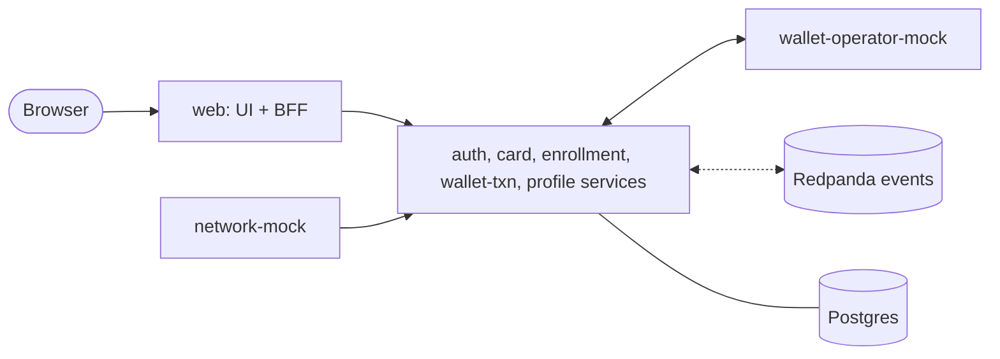

# CardVault

CardVault simulates **one fictional bank's side of a bank-backed online checkout wallet**:
the bank enrols its customers' eligible cards into a wallet run by an external operator,
keeps the system of record for enrolments and wallet purchases, and decides authorizations
when a wallet purchase arrives from the card network. Every bank, operator and network here
is fictional.

It is an **application under test**: it exists so that API and UI test frameworks can be
built against realistic behaviour (auth, idempotency, events, signed callbacks, failures,
reconciliation) with test-only controls, deterministic seed data and observable state.

> Build status: complete (all 6 phases in `SPEC.md` section 13). The API test suite
> (pytest + httpx) lives in `tests/api/`; the Playwright suite will live in `tests/ui/`;
> `evals/` is reserved for agent evaluations.

## How it fits together



The customer uses the web app; the network mock plays merchants and the card network; the
operator mock plays the external wallet operator (signed requests both ways). Services talk
to each other through Kafka events written with a transactional outbox. `ARCHITECTURE.md`
has the full service map, the enrolment and purchase sequences, and every design decision.

## Quick start

Requirements: Docker with Compose v2, GNU Make, curl, python3.

```bash
make up      # build and start the stack, wait until healthy (copies .env.example to .env)
make seed    # load the deterministic seed data
make smoke   # end-to-end smoke test
```

| URL | What |
|---|---|
| http://localhost:3000 | Web app (sign in as `alice`) |
| http://localhost:8001/docs | auth-service OpenAPI |
| http://localhost:8002/docs | card-service OpenAPI |
| http://localhost:8003/docs | enrollment-service OpenAPI (wallet) |
| http://localhost:8004/docs | wallet-txn-service OpenAPI (transactions, export, disputes) |
| http://localhost:8005/docs | profile-service OpenAPI |
| http://localhost:8101/docs | wallet-operator-mock OpenAPI (`/embed/terms`, `/help`) |
| http://localhost:8102/docs | network-mock OpenAPI |
| http://localhost:8080 | Redpanda Console |
| `127.0.0.1:19092` | Kafka (Redpanda) from the host |
| `127.0.0.1:5432` | Postgres (read-only roles in `.env.example`) |

Seed logins: `alice`, `bob`, `charlie`, `dana`, password in `.env.example`
(`SEED_USER_PASSWORD`).

```bash
curl -s localhost:8001/v1/auth/login -H 'content-type: application/json' \
  -d '{"username":"alice","password":"CardVault-Demo-1"}'
```

Simulate a wallet purchase on alice's enrolled credit card, then settle it:

```bash
curl -s localhost:8102/v1/test/purchases -H 'X-Test-Key: cv-test-key-local' \
  -H 'content-type: application/json' \
  -d '{"token_ref":"tok_a11ce0c4ed170000000001","amount":1250,"merchant_name":"Coffee"}'
curl -s -X POST localhost:8102/v1/test/purchases/<trace_id>/settle -H 'X-Test-Key: cv-test-key-local'
```

View alice's wallet, report her credit card lost and watch the enrolment become SUSPENDED
(the operator mock confirms by signed callback about 2 seconds later):

```bash
TOKEN=$(curl -s localhost:8001/v1/auth/login -H 'content-type: application/json' \
  -d '{"username":"alice","password":"CardVault-Demo-1"}' | python3 -c 'import json,sys; print(json.load(sys.stdin)["access_token"])')
curl -s localhost:8003/v1/wallet -H "Authorization: Bearer $TOKEN"
curl -s -X POST localhost:8002/v1/cards/ca4d0000-a11c-4000-8000-000000000001/report-lost \
  -H "Authorization: Bearer $TOKEN"
sleep 3; curl -s localhost:8003/v1/wallet/cards/ca4d0000-a11c-4000-8000-000000000001 \
  -H "Authorization: Bearer $TOKEN"
```

List alice's wallet transactions (the purchase above appears within a second), export them,
dispute one, and run reconciliation against the operator's daily file:

```bash
curl -s "localhost:8004/v1/wallet/transactions?status=SETTLED&limit=5" -H "Authorization: Bearer $TOKEN"
curl -s "localhost:8004/v1/wallet/transactions/export?from=2026-11-01&to=2026-11-30" \
  -H "Authorization: Bearer $TOKEN" -OJ
curl -s localhost:8004/v1/wallet/transactions/<txn_id>/disputes -H "Authorization: Bearer $TOKEN" \
  -F reason=WRONG_AMOUNT -F note='Charged twice' -F receipt=@receipt.png
curl -s localhost:8003/internal/v1/reconciliation/runs -H 'X-Service-Key: cv-svc-tests-local' \
  -H 'content-type: application/json' -d '{}'
```

## Make targets

| Target | What it does |
|---|---|
| `up` / `down` / `clean` | Start (build, wait healthy) / stop / stop and delete volumes |
| `seed` / `reset` | Load seed data / reset every service, clear the clock offset, reseed |
| `smoke` | Run `scripts/smoke.sh` |
| `logs` | Follow container logs |
| `ci-up` | Start with `docker-compose.ci.yml` (CI limits), wait, seed |
| `bug-up BUG=<FLAG>` | Start with exactly one seeded-bug flag on (list: `scripts/bugs.txt`) |
| `lint` / `format` / `events` | ruff checks / ruff fixes / regenerate `docs/events` |

## Test controls (TEST_MODE only, header `X-Test-Key`)

Every service: `POST /test/reset`, `POST /test/seed`, `GET|POST /test/faults`,
`GET|POST /test/clock`, `GET /test/quiet`, `GET /test/bugs`. See `ARCHITECTURE.md`.

- enrollment-service: `POST /test/customers` (a fresh customer with cards, optionally
  enrolled), `GET /test/enrollments` (includes `token_ref`), and the daily sweep at
  `POST /internal/v1/sweep` (tests `X-Service-Key`).
- Both mocks: `GET|POST /test/behaviour` (controls) and `GET|POST /test/state`.

## Seeded bugs

CardVault ships with known defects that test suites are meant to find. Each is behind one
environment flag, off by default (with every flag off the app behaves as specified).
`make bug-up BUG=BUG_PAN_IN_LOGS` rebuilds and starts the stack with just that flag on, and
`GET /test/bugs` on any service shows what it sees. The flag names are in `scripts/bugs.txt`
and `app/shared/bugs.py`; what each one breaks is for the tests to discover.

## Continuous integration

`.github/workflows/app-ci.yml` lints and then starts the whole stack inside the GitHub runner
with `.github/actions/start-stack`, runs the smoke test, and uploads the container logs.
Test workflows reuse the same composite action:

```yaml
- uses: ./.github/actions/start-stack
  with:
    bug_flag: ""        # optional: one seeded-bug flag
    test_mode: "true"
```

## Docs

- `SPEC.md`: the build spec (section 16 overrides earlier sections)
- `ARCHITECTURE.md`: design decisions and tradeoffs
- `docs/errors.md`: every error code
- `docs/events/`: JSON Schemas for every event
- `docs/STAGING.md`: the stage VM, its pages and links, Caddy, firewall, systemd and how to rebuild it
